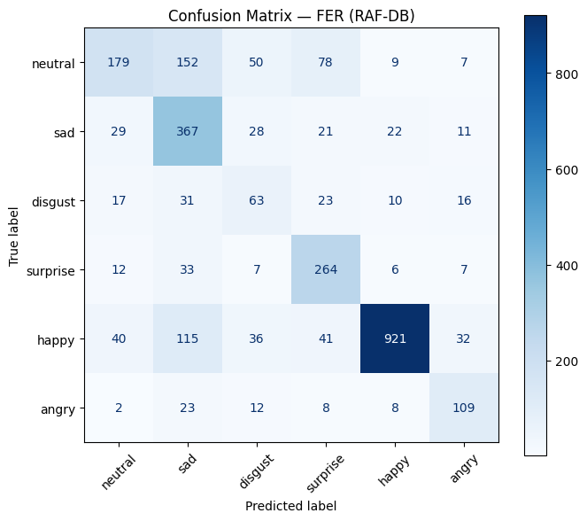

# 🎭 Facial Emotion Recognition (RAF-DB)

> **Graduation Project — Step IT Academy**\
> _Final project · graded 10/10, finished top of my class_\
> _Built before starting university (now a 1st-year Computer Science student)_
>
> Trained from scratch in TensorFlow, served live through Flask + OpenCV.

## Description

This is a small project where I built a convolutional neural network that recognizes
**facial emotions in real time from the webcam**. You open a page in the browser, it grabs
frames from your camera, finds your face, and tells you which of 6 emotions it thinks you're
showing, together with how confident it is.

I trained the model myself on the **RAF-DB** dataset (no pre-trained weights), and wrote a
little Flask server that runs the whole thing locally. The point was less about getting a
state-of-the-art score and more about understanding every step: how the data is loaded, how a
CNN is put together, and how you actually *serve* a model instead of just leaving it in a
notebook.

**Emotions it detects:** `neutral` · `sad` · `disgust` · `surprise` · `happy` · `angry`
_(RAF-DB also has `fear`, but I dropped it — see the notes at the end for why.)_

## Explore

1. [What it does](#what-it-does)
2. [Tech used](#tech-used)
3. [How it works](#how-it-works)
4. [Model architecture](#model-architecture)
5. [Results](#results)
6. [Notes & things I learned](#notes--things-i-learned)
7. [How to run it](#how-to-run-it)
8. [Dataset](#dataset)
9. [References](#references)

## What it does

- Runs **live from the webcam** — no uploading images, it reads frames every ~1.5s.
- Detects the face first (OpenCV Haar cascade) so the model only looks at the face, not the background.
- Returns the predicted emotion **+ a confidence score**, and says `"no emotion"` when it's not sure enough.
- The whole model is tiny (~4.6 MB), so it runs fine on a laptop CPU.

## Tech used

| Part | What I used |
| --- | --- |
| Model | TensorFlow / Keras |
| Face detection | OpenCV (Haar cascade) |
| Backend | Flask |
| Frontend | plain HTML + JS (`getUserMedia`) |
| Dataset | RAF-DB, pulled with `kagglehub` |

## How it works

The flow from camera to prediction:

```
webcam frame → base64 JPEG → POST /predict
   → decode → grayscale → detect face → crop
   → resize to 48×48 → normalize to [0,1]
   → CNN → softmax → argmax (+ confidence threshold)
   → { emotion, probability }
```

Step by step:

1. The browser captures a frame and sends it to the server as base64.
2. The server decodes it and converts it to **grayscale** — expressions don't really depend on color, and I trained on grayscale anyway.
3. A Haar cascade finds the face. If there's no face, it just returns `"no face"` and skips everything else.
4. The face is cropped, resized to **48×48** and scaled to `[0,1]` — exactly the format the model saw during training. (This part matters a lot: if the preprocessing here doesn't match training, predictions go bad.)
5. The CNN outputs a probability for each of the 6 emotions.
6. If the top probability is below **0.25**, it returns `"no emotion"` instead of guessing.

## Model architecture

Nothing fancy — a stack of conv blocks, each one `Conv → BatchNorm → MaxPool → Dropout`,
then a dense head. I kept it small on purpose because the dataset isn't huge and I didn't want
it to overfit instantly.

| Layer | Config | What it's for |
| --- | --- | --- |
| Conv2D | 32, 3×3, ReLU | basic edges / curves |
| Conv2D | 64, 3×3, ReLU | slightly bigger patterns |
| BatchNorm + MaxPool + Dropout(0.25) | — | stabilize, shrink, regularize |
| Conv2D | 128, 5×5, ReLU | wider features (mouth, eyebrows) |
| BatchNorm + MaxPool + Dropout(0.25) | — | |
| Conv2D | 256, 3×3, ReLU, L2(0.001) | deepest features, L2 to fight overfitting |
| BatchNorm + MaxPool + Dropout(0.25) | — | |
| Flatten | — | |
| Dense | 256, ReLU | |
| Dropout(0.5) | — | heavy dropout before the output |
| Dense | 6, Softmax | one probability per emotion |

Training setup: **Adam** (lr `0.0001`), **categorical crossentropy**, **30 epochs**, batch size
**32**. I also augment the training images a bit (random zoom + horizontal flip) and I cap the
`neutral` class, because otherwise it dominates and the model just learns to say "neutral" all
the time.

## Results

**Test accuracy: ~68%.**



Per class (read off the confusion matrix):

| Emotion | Accuracy | Comment |
| --- | --- | --- |
| surprise | ~80% | best — surprised faces are pretty distinct |
| happy | ~78% | strong, but see the imbalance note below |
| sad | ~77% | strong |
| angry | ~67% | ok |
| neutral | ~38% | weak, gets mixed up with sad / surprise |
| disgust | ~39% | worst, spreads all over the place |

So the 68% is a bit of an optimistic number. RAF-DB has *way* more `happy` images than
`disgust` ones (something like 1185 vs 160 in the test set), so the easy, big class pulls the
average up. The honest summary: it's good on happy / sad / surprise, and struggles on neutral
and disgust.

## Notes & things I learned

This is the part I actually want to remember, so I'm writing it down.

- **The label-order bug.** My biggest headache. I built the class list dynamically from the
  dataset folders using `glob()`, and it turns out `glob()` doesn't return folders in a
  guaranteed order. So on one run the classes came out as
  `['neutral', 'sad', 'disgust', 'surprise', 'happy', 'angry']`, and on another run in a
  *different* order. My confusion matrix looked completely random (almost nothing on the
  diagonal) even though the model was fine — the model was predicting correctly, I was just
  **labeling the axes wrong**. The fix: pin the class order explicitly instead of trusting
  `glob()`, and make sure training, evaluation and the server all use the *same* order. Lesson
  learned: never trust filesystem ordering.

- **Preprocessing has to match exactly.** The server has to do the same grayscale → 48×48 →
  `/255` steps as training. The first time I got it slightly off, the live predictions were
  nonsense even though the test accuracy was fine.

- **Dropping `fear`.** RAF-DB has 7 emotions but `fear` has very few samples and the model
  basically never got it right, so I removed it and kept 6. Cleaner results, and honestly fear
  and surprise look almost the same on a 48×48 grayscale face.

- **Class imbalance is real.** Capping `neutral` helped, but `disgust` is still bad simply
  because there isn't enough of it. If I come back to this, I'd try class weights or oversampling.

- **`debug=True` in Flask** is fine for running this locally, but I know it shouldn't be left on
  for anything public.

## How to run it

```bash
git clone https://github.com/andrei-dada/FinalProjectRAF.git
cd FinalProjectRAF

python3 -m venv .venv
source .venv/bin/activate
pip install -r REQUIREMENTS.txt

python serverRAF.py
```

Then open **http://127.0.0.1:5001** and allow camera access.

To retrain, open `training.ipynb` and run it top to bottom — it downloads RAF-DB automatically
with `kagglehub` and saves `modelRAF.h5` at the end.

## Dataset

[**RAF-DB (Real-world Affective Faces)**](https://www.kaggle.com/datasets/shuvoalok/raf-db-dataset),
downloaded through `kagglehub`.

> I'm **not** uploading the dataset to this repo — it has an academic / non-commercial license,
> so it gets pulled automatically at training time instead.

## References

1. RAF-DB dataset — https://www.kaggle.com/datasets/shuvoalok/raf-db-dataset
2. TensorFlow / Keras docs — https://www.tensorflow.org/api_docs
3. OpenCV Haar cascades — https://docs.opencv.org/4.x/db/d28/tutorial_cascade_classifier.html
4. Confusion matrix / metrics — https://scikit-learn.org/stable/modules/model_evaluation.html

---

> _Bonus: 20% of the time I spent "training a neural network" was actually me staring at a
> confusion matrix wondering why the diagonal was empty._
